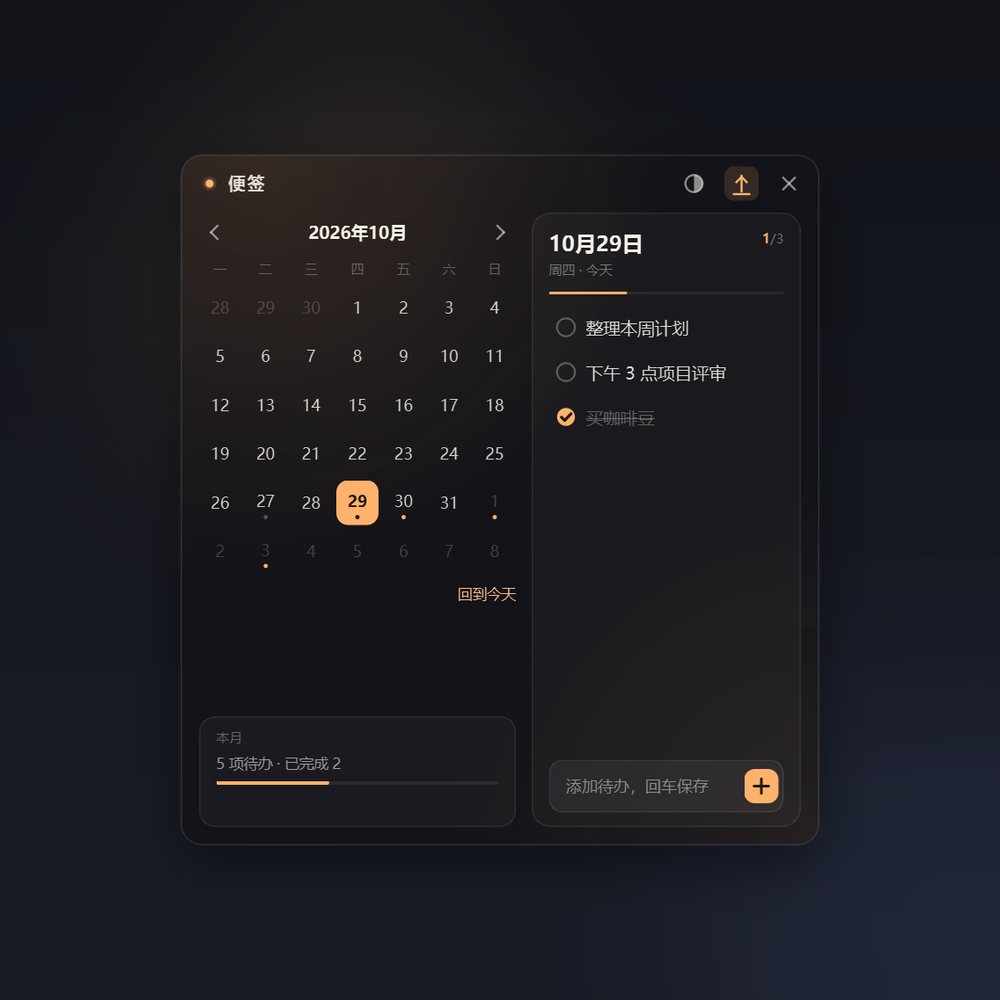

# 桌面便签 Lite

A translucent, always-on-top desktop sticky note for Windows: a month calendar on the left and daily todos on the right. Built with **PySide6 native widgets** — no Electron or browser engine.



## 下载

[**DesktopNotesLite.exe**](https://github.com/TODAYmiao/desktop-notes-lite/releases/latest) — Windows 10/11 64 位，无需安装 Python。

## 功能

- **半透明无边框小组件**：拖动顶栏移动，位置自动记忆，可切换始终置顶
- **月历 + 每日待办**：点日期切换当天列表；有未完成显示橙点，全部完成显示灰点
- **待办操作**：回车添加、点圆圈完成、双击文字编辑、悬停 × 删除
- **调色盘**：7 个预设色 + 自定义取色器，颜色会联动强调色和背景光晕
- **不透明度**：35%–95% 可调
- **系统托盘**：显示/隐藏、始终置顶、开机自启、退出
- **单实例运行**：重复启动只会唤回已有窗口
- **本地存储**：JSON 自动保存，无需账号或网络

## 环境

- Windows 10 / 11
- Python 3.12+
- PySide6 6.10+（见 `requirements.txt`）

托盘和开机自启使用 Windows API，其他平台未测试。

## 运行

推荐使用 [uv](https://docs.astral.sh/uv/)：

```bat
uv venv .venv --python 3.12
uv pip install --python .venv\Scripts\python.exe -r requirements.txt
.venv\Scripts\python.exe main.py
```

或者使用 pip：

```bat
py -m venv .venv
.venv\Scripts\activate
pip install -r requirements.txt
python main.py
```

环境建好后，也可以双击 `start.vbs`（无控制台）或 `debug.bat`（保留控制台方便看报错）。

## 打包

```bat
.venv\Scripts\pyinstaller.exe --noconfirm --clean --onefile --windowed --name "DesktopNotesLite" --icon "assets/icon.ico" --add-data "assets;assets" main.py
```

产物在 `dist\DesktopNotesLite.exe`。单文件版约 41 MB，启动约 2.6 秒；在作者机器上空闲内存约 30–55 MB。

## 数据位置

```
%APPDATA%\DesktopNotesLite\notes.json
```

首次启动自动创建。格式是按日期分组的待办列表：

```json
{
  "todos": {
    "2026-10-29": [
      { "id": "...", "text": "整理本周计划", "done": false, "createdAt": 1 }
    ]
  },
  "settings": { "opacity": 80, "alwaysOnTop": true, "accent": "#ffb26b" }
}
```

窗口位置保存在同目录的 `window-state.json`。

## 项目结构

```
main.py              入口：单实例、启动窗口
app/theme.py         配色、明暗对比、全局 QSS
app/store.py         JSON 读写
app/widgets.py       自绘按钮、日期格、勾选圈、色块、开关、待办行
app/window.py        主窗口、日历、待办、托盘、开机自启
assets/              应用图标、托盘图标
screenshots/         README 截图
start.vbs            无控制台启动
debug.bat            带控制台调试启动
```

## 说明

- 这是个人项目，界面和交互按桌面便签场景设计，窗口固定 500×540。
- 开机自启写入当前用户注册表 `HKCU\Software\Microsoft\Windows\CurrentVersion\Run`，可在托盘菜单或 ◐ 浮层中开关。
- 关闭按钮是“收进托盘”，真正退出请用托盘菜单的「退出」。

## License

MIT
